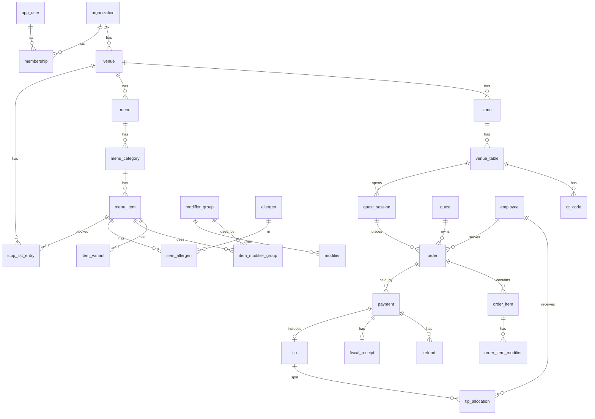
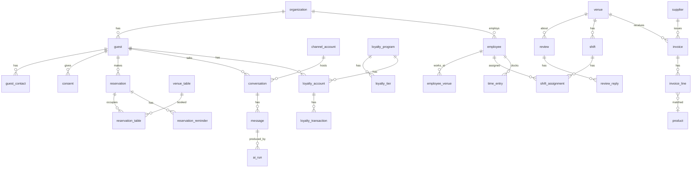

# Доменная модель и схема БД (PostgreSQL)

Дата: 30.10.2026. Статус: черновик v1, основа для MVP. Основано на `research/00-strategy.md` и `sales/product-roadmap.md`.
Язык документа русский, идентификаторы в коде и БД английские (`snake_case`).

## 1. Ключевые решения

| # | Решение | Почему |
|---|---|---|
| 1 | **Одна БД PostgreSQL 16 в РФ (Yandex Cloud / Selectel, сертифицированный по 152-ФЗ контур), shared schema, `organization_id` в каждой бизнес-таблице + Row Level Security** | Сотни-тысячи мелких тенантов; schema-per-tenant не масштабируется по миграциям. RLS страхует от утечки между тенантами при ошибке в коде |
| 2 | **Иерархия `organization → venue → zone → table`**; `brand` опционален для сетей | Юрлицо платит, заведение работает. Сеть из 5 точек = 1 организация, 5 venue |
| 3 | **Первичные ключи UUIDv7** (`uuid` тип, генерация в приложении) | Сортируемы по времени, безопасны в URL QR-кодов, нет коллизий при офлайн-создании и импорте из iiko/Poster |
| 4 | **Деньги — `bigint` в копейках** + `currency char(3) default 'RUB'` | Нет ошибок округления; эквайеры и СБП работают в копейках |
| 5 | **Внешние системы — через `external_ref` (source, external_id)** с уникальностью по `(venue_id, source, external_id)` | Мы работаем «поверх кассы»: меню и стоп-лист — истина в iiko/Poster, у нас — синхронизированная копия |
| 6 | **Снимок позиции в заказе** (`order_item.name_snapshot`, `price_snapshot`, модификаторы в `jsonb`) | Меню меняется; заказ и чек должны остаться неизменными для 54-ФЗ и аналитики |
| 7 | **Переводы — отдельная таблица `translation` (entity, field, locale)**, а не jsonb в каждой колонке | Единый механизм для меню, модификаторов, аллергенов; удобно для пакетного LLM-перевода и ручной правки |
| 8 | **ПДн гостя изолированы** в `guest` / `guest_contact`; телефон хранится как `phone_hash` (HMAC) для поиска + `phone_enc` (pgcrypto/приложенческое шифрование); согласия — `consent` с версией текста | 152-ФЗ: минимизация, учёт согласий, удаление по запросу (анонимизация вместо DELETE, чтобы не ломать заказы) |
| 9 | **Платёж отделён от заказа** (`payment` N:1 к `order`, `payment` поддерживает split bill), чаевые — отдельная сущность `tip` с распределением `tip_allocation` | Счёт делят несколько гостей; чаевые идут не заведению, а сотруднику(ам) через партнёра (CloudTips-подобная схема) |
| 10 | **Аудит-лог append-only, партиционирован по месяцу**, пишется триггером на чувствительные таблицы + из приложения для бизнес-событий; outbox-таблица для событий в интеграции | Разбор споров по деньгам и стоп-листу, требования 152-ФЗ к журналированию доступа к ПДн; надёжная доставка в кассу/боты |

Прочие соглашения:
- Все таблицы: `created_at timestamptz default now()`, `updated_at timestamptz`, мягкое удаление `deleted_at` только у справочников (меню, сотрудники, столы). Финансовые записи не удаляются никогда.
- Время — `timestamptz` в UTC; у `venue.timezone` (IANA, напр. `Asia/Yekaterinburg`) — для отчётов «за смену/день».
- Статусы — `text` + `CHECK` (а не PG `enum`): проще миграции.
- Оптимистичная блокировка: `version int` у `menu_item`, `order`, `reservation`.

## 2. Модули (bounded contexts)

| Контекст | Таблицы | Владелец данных |
|---|---|---|
| Tenancy & IAM | organization, brand, venue, zone, venue_table, qr_code, app_user, membership, role | Мы |
| Menu | menu, menu_category, menu_item, item_variant, modifier_group, modifier, item_modifier_group, allergen, item_allergen, stop_list_entry, translation, media | Касса (iiko/Poster) или мы |
| Ordering | guest_session, order, order_item, order_item_modifier, order_status_history | Мы → касса |
| Payments | payment, payment_split, refund, fiscal_receipt, tip, tip_allocation, payout | Эквайер/партнёр, у нас реестр |
| Guests & CRM | guest, guest_contact, consent, guest_tag, guest_visit | Мы (ПДн) |
| Loyalty | loyalty_program, loyalty_tier, loyalty_account, loyalty_transaction, promo_code | Мы или UDS (white-label) |
| Reservations | reservation, reservation_table, reservation_reminder, waitlist_entry | Мы или Restoplace |
| Conversations / AI | channel_account, conversation, message, ai_run | Мы |
| Reviews | review_source, review, review_reply | Яндекс Карты, 2ГИС |
| Staff | employee, employee_venue, position, shift, shift_assignment, time_entry, staff_forecast | Мы |
| Procurement | supplier, invoice, invoice_line, product (ингредиент), invoice_line_match | OCR + учёт |
| Platform | integration, sync_job, outbox_event, audit_log, file_object, subscription, feature_flag | Мы |

## 3. ER-диаграмма (mermaid)

### 3.1. Тенанты, меню, заказы, платежи



### 3.2. Гости, брони, лояльность, отзывы, сотрудники, накладные



## 4. Описание сущностей

### 4.1. Tenancy

| Таблица | Назначение | Ключевые поля |
|---|---|---|
| organization | Клиент-юрлицо (ООО/ИП), плательщик подписки | `legal_name`, `inn` (10/12), `kpp`, `ogrn`, `tax_system` (`osn`,`usn_income`,`usn_income_expense`,`patent`), `plan`, `status` |
| brand | Бренд сети (опционально) | `name`, `logo_file_id` |
| venue | Точка | `slug` (для URL меню), `address`, `geo point`, `timezone`, `default_locale`, `currency`, `service_charge_bps`, `pos_system` (`none`,`iiko`,`poster`,`rkeeper`), `settings jsonb` |
| zone | Зал / терраса / бар | `name`, `sort` |
| venue_table | Стол | `label` («12», «Бар-3»), `seats_min/max`, `is_active`, `layout jsonb` (x,y,shape) |
| qr_code | QR на столе/входе/доставке | `token` (22 символа base62, неугадываемый), `kind` (`table`,`venue`,`takeaway`,`review`), `table_id` nullable |
| app_user | Учётка B2B-пользователя (владелец, менеджер, официант) | `phone`, `email`, `password_hash` nullable (вход по OTP/Telegram) |
| membership | Пользователь в организации | `role` (`owner`,`admin`,`manager`,`waiter`,`cook`,`accountant`,`partner_integrator`), `venue_ids uuid[]` (null = все) |

### 4.2. Меню

| Таблица | Назначение / правила |
|---|---|
| menu | Несколько меню на venue (основное, бар, бизнес-ланч), `schedule jsonb` (дни/часы), `source` (`manual`,`iiko`,`poster`) |
| menu_category | Дерево через `parent_id`, `sort`, `is_visible` |
| menu_item | `name`, `description`, `price` (коп.), `weight_g`/`volume_ml`, `kcal`, `bju jsonb`, `tags text[]` (`spicy`,`vegan`,`new`,`hit`), `upsell_item_ids uuid[]`, `vat_rate` (`none`,`0`,`5`,`7`,`10`,`22`), `payment_object` (для чека, обычно `commodity`), `marking_required` (пиво/вода — «Честный знак») |
| item_variant | Размеры («0,3/0,5 л»), своя цена |
| modifier_group | `min_select`, `max_select`, `is_required` |
| modifier | `name`, `price_delta` (может быть 0), `external_ref` |
| allergen | Справочник 14 аллергенов (ТР ТС 022/2011) + пользовательские |
| stop_list_entry | `item_id` или `modifier_id`, `remaining_qty` nullable (null = полностью нет), `reason`, `source` (`pos`,`manual`,`ai`), `valid_until`. Позиция скрыта/«нет в наличии», если есть активная запись |
| translation | `(organization_id, entity_type, entity_id, field, locale)` unique; `text`, `status` (`machine`,`reviewed`), `source_hash` — для пересчёта при изменении оригинала |
| media | Фото позиций в S3-совместимом хранилище РФ (Yandex Object Storage) |

### 4.3. Заказы

Жизненный цикл `order.status`:
`draft → submitted → accepted → in_kitchen → ready → served → closed`, ветки `rejected`, `cancelled`. Отдельно `payment_status`: `unpaid → partially_paid → paid → refunded/partially_refunded`.

| Поле order | Значение |
|---|---|
| `number` | Короткий номер за день по venue (последовательность через `venue_order_counter`) |
| `type` | `dine_in`, `takeaway`, `delivery`, `pay_only` (гость только оплачивает счёт из кассы) |
| `channel` | `qr`, `waiter_app`, `telegram`, `vk`, `max`, `phone_ai`, `pos_import` |
| `subtotal`, `discount_total`, `service_charge`, `total` | копейки, `total = subtotal - discount + service_charge` (CHECK) |
| `pos_order_id` | ID заказа в iiko/Poster после отправки |
| `waiter_id` | `employee`, для чаевых и аналитики |
| `guest_id` | nullable — анонимный гость допустим |

### 4.4. Платежи и чаевые

| Таблица | Правила |
|---|---|
| payment | `provider` (`sbp`,`card`,`yandex_pay`,`sber_pay`,`cash`,`pos`), `provider_payment_id`, `amount`, `tip_amount`, `fee_amount`, `status` (`pending`,`authorized`,`succeeded`,`failed`,`cancelled`), `idempotency_key` UNIQUE, `paid_at`. СБП-платёж по QR НСПК: хранится `qrc_id` |
| payment_split | Какие `order_item` (и доля) покрывает платёж при разделении счёта |
| refund | Возвраты, всегда новой строкой |
| fiscal_receipt | Чек 54-ФЗ через ОФД/облачную кассу партнёра: `fn_number`, `fd_number`, `fpd`, `ofd_url`, `type` (`sale`,`refund`) |
| tip | `amount`, `target` (`employee`,`team`,`venue`), `provider` (CloudTips/Нетмонет-подобный партнёр), `rating` 1–5, `comment` |
| tip_allocation | `employee_id`, `amount`, `payout_status` |

Решение: чаевые по закону — доход сотрудника, не выручка заведения; поэтому мы не держим деньги, а проводим через партнёра-агрегатора чаевых, храним реестр.

### 4.5. Гости и CRM (ПДн)

| Таблица | Поля |
|---|---|
| guest | `display_name`, `birthday` (date, только с согласием), `locale`, `source`, `first_visit_at`, `last_visit_at`, `visits_count`, `total_spent` (денормализовано, пересчёт джобом), `rfm_segment`, `anonymized_at` |
| guest_contact | `kind` (`phone`,`email`,`telegram`,`vk`,`max`), `value_enc bytea`, `value_hash bytea` (HMAC-SHA256 с ключом организации), `is_verified` |
| consent | `purpose` (`pd_processing`,`marketing`,`ai_processing`), `document_version`, `granted_at`, `revoked_at`, `channel`, `evidence jsonb` (IP, текст чекбокса) |

С 01.09.2025 согласие на обработку ПДн оформляется отдельным документом — поэтому `consent` отдельная сущность с версией документа. Рассылки — только при `marketing` (38-ФЗ «О рекламе»).

### 4.6. Брони

`reservation.status`: `requested → confirmed → reminded → seated → completed`, ветки `cancelled`, `no_show`. Поля: `starts_at`, `ends_at` (`tstzrange` + EXCLUDE-ограничение по столу против двойной брони), `party_size`, `deposit_amount`, `deposit_payment_id`, `channel`, `external_ref` (Restoplace). Напоминания за 24 и 3 часа — `reservation_reminder` (`scheduled_at`, `channel`, `status`, `response` `confirm|cancel`).

### 4.7. Лояльность

| Таблица | Правила |
|---|---|
| loyalty_program | `type` (`points`,`cashback`,`stamps`), `earn_bps`, `max_redeem_bps` (доля чека, например 30%), `points_ttl_days`, `provider` (`internal`,`uds`,`premium_bonus`) |
| loyalty_tier | `threshold_spent`, `earn_bps` |
| loyalty_account | `balance` — денормализация, источник истины — сумма транзакций |
| loyalty_transaction | `kind` (`earn`,`redeem`,`expire`,`adjust`,`reverse`), `amount`, `order_id`, `expires_at`; только append |

### 4.8. Отзывы

`review_source` (`yandex_maps`,`2gis`,`google`,`internal`,`tip_form`), `review` (`rating`, `text`, `author_name`, `published_at`, `sentiment`, `topics text[]` — «обслуживание», «долго» и т.п.), `review_reply` (`text`, `status`: `draft`,`approved`,`published`,`rejected`; `generated_by_ai_run_id`, `approved_by`). Автопубликация только при `rating >= 4` и настройке владельца.

### 4.9. Сотрудники и смены

| Таблица | Поля |
|---|---|
| employee | ФИО, `phone_enc`, `position_id`, `hourly_rate`, `hired_at`, `fired_at`, `app_user_id` nullable, `tips_wallet_ref` |
| shift | `venue_id`, `starts_at`, `ends_at`, `position_id`, `required_headcount`, `status` (`planned`,`published`,`closed`) |
| shift_assignment | `employee_id`, `status` (`assigned`,`swap_requested`,`confirmed`) |
| time_entry | фактические `clock_in/clock_out` (через QR/Telegram) |
| staff_forecast | Прогноз загрузки по часам: `hour_start`, `expected_orders`, `expected_guests`, `recommended_headcount jsonb`, `model_version` |

### 4.10. Накладные (OCR)

`supplier` (`inn`, `name`), `invoice` (`number`, `date`, `total`, `vat_total`, `status`: `uploaded → recognized → needs_review → approved → exported`, `file_id`, `ocr_confidence`, `edo_doc_id` для УПД из ЭДО), `invoice_line` (`raw_name`, `qty`, `unit`, `price`, `amount`, `vat_rate`, `product_id` после сопоставления, `match_confidence`), `product` (ингредиент/товар склада, `unit`, `external_ref` в iiko). Цель — выгрузка прихода в iiko и контроль роста закупочных цен (`price_change_pct` вычисляется вьюхой).

### 4.11. Каналы и ИИ

`channel_account` (`kind`: `telegram`,`vk`,`max`,`whatsapp`,`phone`,`web`; токены — только ссылка на секрет в Lockbox/Vault, не в БД), `conversation` (`guest_id`, `status`, `handoff_to_human bool`), `message` (`direction`, `text`, `attachments jsonb`), `ai_run` (`provider`: `gigachat`,`yandexgpt`,`self_hosted`; `model`, `prompt_tokens`, `completion_tokens`, `cost_kopecks`, `latency_ms`, `contains_pd bool`, `purpose`). Политика: `contains_pd = true` допускается только с провайдерами в РФ — проверяется CHECK.

### 4.12. Платформа

`integration` (`kind`, `status`, `config jsonb`, `secret_ref`), `sync_job` (`kind`: `menu_import`,`stop_list_pull`,`order_push`; `status`, `error`), `outbox_event` (transactional outbox, `topic`, `payload`, `published_at`), `audit_log`, `subscription` (тариф, модули), `feature_flag`.

## 5. Multi-tenancy и RLS

- Каждое соединение приложения выполняет `SET LOCAL app.org_id = '<uuid>'` в начале транзакции (через пулер PgBouncer в transaction mode — только `SET LOCAL`).
- Политика: `USING (organization_id = current_setting('app.org_id')::uuid)`.
- Роль `app_rw` без `BYPASSRLS`; служебные джобы (биллинг, аналитика) — `app_service` с `BYPASSRLS` и отдельным аудитом.
- Гостевые публичные эндпоинты (меню по QR) резолвят `qr_code.token → venue → organization_id` через функцию `SECURITY DEFINER`, затем ставят контекст.
- Ограничение по `venue_ids` из `membership` — на уровне приложения (RLS только по организации, чтобы не усложнять).

## 6. DDL (PostgreSQL 16)

```sql
CREATE EXTENSION IF NOT EXISTS pgcrypto;
CREATE EXTENSION IF NOT EXISTS btree_gist;
CREATE EXTENSION IF NOT EXISTS citext;

-- ===== Tenancy =====
CREATE TABLE organization (
  id            uuid PRIMARY KEY,
  legal_name    text NOT NULL,
  inn           varchar(12) NOT NULL CHECK (inn ~ '^\d{10}(\d{2})?$'),
  kpp           varchar(9),
  ogrn          varchar(15),
  tax_system    text NOT NULL DEFAULT 'usn_income'
                CHECK (tax_system IN ('osn','usn_income','usn_income_expense','patent')),
  plan          text NOT NULL DEFAULT 'start',
  status        text NOT NULL DEFAULT 'trial' CHECK (status IN ('trial','active','suspended','closed')),
  created_at    timestamptz NOT NULL DEFAULT now(),
  updated_at    timestamptz
);
CREATE UNIQUE INDEX ux_org_inn_kpp ON organization (inn, coalesce(kpp,''));

CREATE TABLE brand (
  id uuid PRIMARY KEY,
  organization_id uuid NOT NULL REFERENCES organization(id),
  name text NOT NULL,
  logo_file_id uuid
);

CREATE TABLE venue (
  id               uuid PRIMARY KEY,
  organization_id  uuid NOT NULL REFERENCES organization(id),
  brand_id         uuid REFERENCES brand(id),
  name             text NOT NULL,
  slug             citext NOT NULL UNIQUE,
  address          text,
  lat numeric(9,6), lon numeric(9,6),
  timezone         text NOT NULL DEFAULT 'Europe/Moscow',
  default_locale   text NOT NULL DEFAULT 'ru',
  currency         char(3) NOT NULL DEFAULT 'RUB',
  service_charge_bps int NOT NULL DEFAULT 0 CHECK (service_charge_bps BETWEEN 0 and 3000),
  pos_system       text NOT NULL DEFAULT 'none' CHECK (pos_system IN ('none','iiko','poster','rkeeper')),
  settings         jsonb NOT NULL DEFAULT '{}',
  created_at timestamptz NOT NULL DEFAULT now(), updated_at timestamptz, deleted_at timestamptz
);
CREATE INDEX ix_venue_org ON venue(organization_id);

CREATE TABLE zone (
  id uuid PRIMARY KEY,
  organization_id uuid NOT NULL REFERENCES organization(id),
  venue_id uuid NOT NULL REFERENCES venue(id),
  name text NOT NULL, sort int NOT NULL DEFAULT 0, deleted_at timestamptz
);

CREATE TABLE venue_table (
  id uuid PRIMARY KEY,
  organization_id uuid NOT NULL REFERENCES organization(id),
  venue_id uuid NOT NULL REFERENCES venue(id),
  zone_id  uuid REFERENCES zone(id),
  label text NOT NULL,
  seats_min int NOT NULL DEFAULT 1, seats_max int NOT NULL DEFAULT 4,
  layout jsonb, is_active boolean NOT NULL DEFAULT true,
  external_source text, external_id text,
  deleted_at timestamptz,
  UNIQUE (venue_id, label)
);

CREATE TABLE qr_code (
  id uuid PRIMARY KEY,
  organization_id uuid NOT NULL REFERENCES organization(id),
  venue_id uuid NOT NULL REFERENCES venue(id),
  table_id uuid REFERENCES venue_table(id),
  token varchar(32) NOT NULL UNIQUE,
  kind text NOT NULL CHECK (kind IN ('table','venue','takeaway','review','tips')),
  is_active boolean NOT NULL DEFAULT true,
  created_at timestamptz NOT NULL DEFAULT now()
);

CREATE TABLE app_user (
  id uuid PRIMARY KEY,
  phone varchar(16) UNIQUE, email citext UNIQUE,
  full_name text, password_hash text, telegram_id bigint UNIQUE,
  last_login_at timestamptz, created_at timestamptz NOT NULL DEFAULT now()
);

CREATE TABLE membership (
  id uuid PRIMARY KEY,
  organization_id uuid NOT NULL REFERENCES organization(id),
  user_id uuid NOT NULL REFERENCES app_user(id),
  role text NOT NULL CHECK (role IN ('owner','admin','manager','waiter','cook','accountant','partner_integrator')),
  venue_ids uuid[],
  UNIQUE (organization_id, user_id)
);

-- ===== Menu =====
CREATE TABLE menu (
  id uuid PRIMARY KEY,
  organization_id uuid NOT NULL REFERENCES organization(id),
  venue_id uuid NOT NULL REFERENCES venue(id),
  name text NOT NULL, schedule jsonb, is_active boolean NOT NULL DEFAULT true,
  source text NOT NULL DEFAULT 'manual' CHECK (source IN ('manual','iiko','poster','rkeeper')),
  external_id text, deleted_at timestamptz
);

CREATE TABLE menu_category (
  id uuid PRIMARY KEY,
  organization_id uuid NOT NULL REFERENCES organization(id),
  menu_id uuid NOT NULL REFERENCES menu(id),
  parent_id uuid REFERENCES menu_category(id),
  name text NOT NULL, sort int NOT NULL DEFAULT 0, is_visible boolean NOT NULL DEFAULT true,
  external_id text, deleted_at timestamptz
);

CREATE TABLE menu_item (
  id uuid PRIMARY KEY,
  organization_id uuid NOT NULL REFERENCES organization(id),
  venue_id uuid NOT NULL REFERENCES venue(id),
  category_id uuid NOT NULL REFERENCES menu_category(id),
  name text NOT NULL, description text,
  price bigint NOT NULL CHECK (price >= 0),
  weight_g int, volume_ml int, kcal int, nutrition jsonb,
  tags text[] NOT NULL DEFAULT '{}',
  upsell_item_ids uuid[] NOT NULL DEFAULT '{}',
  vat_rate text NOT NULL DEFAULT 'none' CHECK (vat_rate IN ('none','0','5','7','10','22')),
  marking_required boolean NOT NULL DEFAULT false,
  image_file_id uuid, sort int NOT NULL DEFAULT 0, is_visible boolean NOT NULL DEFAULT true,
  external_source text, external_id text,
  version int NOT NULL DEFAULT 1,
  created_at timestamptz NOT NULL DEFAULT now(), updated_at timestamptz, deleted_at timestamptz
);
CREATE UNIQUE INDEX ux_item_ext ON menu_item(venue_id, external_source, external_id) WHERE external_id IS NOT NULL;
CREATE INDEX ix_item_cat ON menu_item(category_id) WHERE deleted_at IS NULL;

CREATE TABLE item_variant (
  id uuid PRIMARY KEY,
  organization_id uuid NOT NULL REFERENCES organization(id),
  item_id uuid NOT NULL REFERENCES menu_item(id),
  name text NOT NULL, price bigint NOT NULL CHECK (price >= 0), sort int NOT NULL DEFAULT 0, external_id text
);

CREATE TABLE modifier_group (
  id uuid PRIMARY KEY,
  organization_id uuid NOT NULL REFERENCES organization(id),
  venue_id uuid NOT NULL REFERENCES venue(id),
  name text NOT NULL,
  min_select int NOT NULL DEFAULT 0, max_select int NOT NULL DEFAULT 1,
  CHECK (min_select >= 0 AND max_select >= min_select),
  external_id text
);

CREATE TABLE modifier (
  id uuid PRIMARY KEY,
  organization_id uuid NOT NULL REFERENCES organization(id),
  group_id uuid NOT NULL REFERENCES modifier_group(id),
  name text NOT NULL, price_delta bigint NOT NULL DEFAULT 0, sort int NOT NULL DEFAULT 0, external_id text
);

CREATE TABLE item_modifier_group (
  item_id uuid NOT NULL REFERENCES menu_item(id),
  group_id uuid NOT NULL REFERENCES modifier_group(id),
  organization_id uuid NOT NULL REFERENCES organization(id),
  sort int NOT NULL DEFAULT 0,
  PRIMARY KEY (item_id, group_id)
);

CREATE TABLE allergen (
  id uuid PRIMARY KEY,
  organization_id uuid REFERENCES organization(id), -- NULL = системный справочник
  code text NOT NULL, name text NOT NULL
);
CREATE TABLE item_allergen (
  item_id uuid NOT NULL REFERENCES menu_item(id),
  allergen_id uuid NOT NULL REFERENCES allergen(id),
  organization_id uuid NOT NULL REFERENCES organization(id),
  may_contain boolean NOT NULL DEFAULT false,
  PRIMARY KEY (item_id, allergen_id)
);

CREATE TABLE stop_list_entry (
  id uuid PRIMARY KEY,
  organization_id uuid NOT NULL REFERENCES organization(id),
  venue_id uuid NOT NULL REFERENCES venue(id),
  item_id uuid REFERENCES menu_item(id),
  modifier_id uuid REFERENCES modifier(id),
  remaining_qty numeric(10,3),
  reason text, source text NOT NULL CHECK (source IN ('pos','manual','ai')),
  created_by uuid REFERENCES app_user(id),
  valid_from timestamptz NOT NULL DEFAULT now(), valid_until timestamptz, lifted_at timestamptz,
  CHECK (num_nonnulls(item_id, modifier_id) = 1)
);
CREATE INDEX ix_stop_active ON stop_list_entry(venue_id) WHERE lifted_at IS NULL;

CREATE TABLE translation (
  id uuid PRIMARY KEY,
  organization_id uuid NOT NULL REFERENCES organization(id),
  entity_type text NOT NULL, entity_id uuid NOT NULL,
  field text NOT NULL, locale text NOT NULL,
  text text NOT NULL,
  status text NOT NULL DEFAULT 'machine' CHECK (status IN ('machine','reviewed')),
  source_hash bytea,
  UNIQUE (entity_type, entity_id, field, locale)
);

-- ===== Guests (ПДн) =====
CREATE TABLE guest (
  id uuid PRIMARY KEY,
  organization_id uuid NOT NULL REFERENCES organization(id),
  display_name text, birthday date, locale text,
  source text, first_visit_at timestamptz, last_visit_at timestamptz,
  visits_count int NOT NULL DEFAULT 0, total_spent bigint NOT NULL DEFAULT 0,
  rfm_segment text, tags text[] NOT NULL DEFAULT '{}',
  anonymized_at timestamptz,
  created_at timestamptz NOT NULL DEFAULT now(), updated_at timestamptz
);

CREATE TABLE guest_contact (
  id uuid PRIMARY KEY,
  organization_id uuid NOT NULL REFERENCES organization(id),
  guest_id uuid NOT NULL REFERENCES guest(id),
  kind text NOT NULL CHECK (kind IN ('phone','email','telegram','vk','max','whatsapp')),
  value_enc bytea NOT NULL,
  value_hash bytea NOT NULL,
  is_verified boolean NOT NULL DEFAULT false,
  UNIQUE (organization_id, kind, value_hash)
);

CREATE TABLE consent (
  id uuid PRIMARY KEY,
  organization_id uuid NOT NULL REFERENCES organization(id),
  guest_id uuid NOT NULL REFERENCES guest(id),
  purpose text NOT NULL CHECK (purpose IN ('pd_processing','marketing','ai_processing','cross_border_none')),
  document_version text NOT NULL,
  channel text NOT NULL, evidence jsonb NOT NULL,
  granted_at timestamptz NOT NULL DEFAULT now(), revoked_at timestamptz
);
CREATE INDEX ix_consent_guest ON consent(guest_id, purpose) WHERE revoked_at IS NULL;

-- ===== Staff =====
CREATE TABLE position (
  id uuid PRIMARY KEY, organization_id uuid NOT NULL REFERENCES organization(id),
  name text NOT NULL, kind text CHECK (kind IN ('waiter','bartender','cook','host','manager','runner','cleaner','other'))
);

CREATE TABLE employee (
  id uuid PRIMARY KEY,
  organization_id uuid NOT NULL REFERENCES organization(id),
  app_user_id uuid REFERENCES app_user(id),
  full_name text NOT NULL, phone_enc bytea,
  position_id uuid REFERENCES position(id),
  hourly_rate bigint, tips_wallet_ref text,
  hired_at date, fired_at date, deleted_at timestamptz
);

CREATE TABLE employee_venue (
  employee_id uuid NOT NULL REFERENCES employee(id),
  venue_id uuid NOT NULL REFERENCES venue(id),
  organization_id uuid NOT NULL REFERENCES organization(id),
  PRIMARY KEY (employee_id, venue_id)
);

CREATE TABLE shift (
  id uuid PRIMARY KEY,
  organization_id uuid NOT NULL REFERENCES organization(id),
  venue_id uuid NOT NULL REFERENCES venue(id),
  position_id uuid REFERENCES position(id),
  period tstzrange NOT NULL,
  required_headcount int NOT NULL DEFAULT 1,
  status text NOT NULL DEFAULT 'planned' CHECK (status IN ('planned','published','closed'))
);
CREATE INDEX ix_shift_period ON shift USING gist (venue_id, period);

CREATE TABLE shift_assignment (
  id uuid PRIMARY KEY,
  organization_id uuid NOT NULL REFERENCES organization(id),
  shift_id uuid NOT NULL REFERENCES shift(id),
  employee_id uuid NOT NULL REFERENCES employee(id),
  status text NOT NULL DEFAULT 'assigned' CHECK (status IN ('assigned','confirmed','swap_requested','declined')),
  UNIQUE (shift_id, employee_id)
);

CREATE TABLE time_entry (
  id uuid PRIMARY KEY,
  organization_id uuid NOT NULL REFERENCES organization(id),
  employee_id uuid NOT NULL REFERENCES employee(id),
  venue_id uuid NOT NULL REFERENCES venue(id),
  shift_assignment_id uuid REFERENCES shift_assignment(id),
  clock_in timestamptz NOT NULL, clock_out timestamptz,
  CHECK (clock_out IS NULL OR clock_out > clock_in)
);

CREATE TABLE staff_forecast (
  id uuid PRIMARY KEY,
  organization_id uuid NOT NULL REFERENCES organization(id),
  venue_id uuid NOT NULL REFERENCES venue(id),
  hour_start timestamptz NOT NULL,
  expected_orders numeric(8,2), expected_guests numeric(8,2),
  recommended_headcount jsonb, model_version text NOT NULL,
  UNIQUE (venue_id, hour_start, model_version)
);

-- ===== Ordering =====
CREATE TABLE guest_session (
  id uuid PRIMARY KEY,
  organization_id uuid NOT NULL REFERENCES organization(id),
  venue_id uuid NOT NULL REFERENCES venue(id),
  table_id uuid REFERENCES venue_table(id),
  qr_code_id uuid REFERENCES qr_code(id),
  guest_id uuid REFERENCES guest(id),
  locale text, user_agent text,
  started_at timestamptz NOT NULL DEFAULT now(), ended_at timestamptz
);

CREATE TABLE "order" (
  id uuid PRIMARY KEY,
  organization_id uuid NOT NULL REFERENCES organization(id),
  venue_id uuid NOT NULL REFERENCES venue(id),
  table_id uuid REFERENCES venue_table(id),
  guest_session_id uuid REFERENCES guest_session(id),
  guest_id uuid REFERENCES guest(id),
  waiter_id uuid REFERENCES employee(id),
  number int NOT NULL,
  business_date date NOT NULL,
  type text NOT NULL CHECK (type IN ('dine_in','takeaway','delivery','pay_only')),
  channel text NOT NULL CHECK (channel IN ('qr','waiter_app','telegram','vk','max','phone_ai','pos_import','web')),
  status text NOT NULL DEFAULT 'draft'
    CHECK (status IN ('draft','submitted','accepted','in_kitchen','ready','served','closed','rejected','cancelled')),
  payment_status text NOT NULL DEFAULT 'unpaid'
    CHECK (payment_status IN ('unpaid','partially_paid','paid','partially_refunded','refunded')),
  subtotal bigint NOT NULL DEFAULT 0, discount_total bigint NOT NULL DEFAULT 0,
  service_charge bigint NOT NULL DEFAULT 0, total bigint NOT NULL DEFAULT 0,
  CHECK (total = subtotal - discount_total + service_charge AND total >= 0),
  currency char(3) NOT NULL DEFAULT 'RUB',
  comment text, pos_order_id text, promo_code_id uuid,
  version int NOT NULL DEFAULT 1,
  created_at timestamptz NOT NULL DEFAULT now(), updated_at timestamptz, closed_at timestamptz,
  UNIQUE (venue_id, business_date, number)
);
CREATE INDEX ix_order_venue_date ON "order"(venue_id, business_date);
CREATE INDEX ix_order_guest ON "order"(guest_id) WHERE guest_id IS NOT NULL;
CREATE INDEX ix_order_open ON "order"(venue_id, status) WHERE status NOT IN ('closed','rejected','cancelled');

CREATE TABLE order_item (
  id uuid PRIMARY KEY,
  organization_id uuid NOT NULL REFERENCES organization(id),
  order_id uuid NOT NULL REFERENCES "order"(id),
  menu_item_id uuid REFERENCES menu_item(id),
  variant_id uuid REFERENCES item_variant(id),
  name_snapshot text NOT NULL,
  unit_price bigint NOT NULL,          -- цена с модификаторами за 1 шт.
  quantity numeric(10,3) NOT NULL CHECK (quantity > 0),
  discount bigint NOT NULL DEFAULT 0,
  amount bigint NOT NULL,              -- round(unit_price*quantity) - discount
  vat_rate text NOT NULL,
  status text NOT NULL DEFAULT 'new' CHECK (status IN ('new','cooking','ready','served','voided')),
  void_reason text, comment text,
  added_by text NOT NULL DEFAULT 'guest' CHECK (added_by IN ('guest','waiter','ai','pos')),
  is_upsell boolean NOT NULL DEFAULT false,
  created_at timestamptz NOT NULL DEFAULT now()
);
CREATE INDEX ix_order_item_order ON order_item(order_id);

CREATE TABLE order_item_modifier (
  id uuid PRIMARY KEY,
  organization_id uuid NOT NULL REFERENCES organization(id),
  order_item_id uuid NOT NULL REFERENCES order_item(id),
  modifier_id uuid REFERENCES modifier(id),
  name_snapshot text NOT NULL, price_delta bigint NOT NULL, quantity int NOT NULL DEFAULT 1
);

CREATE TABLE order_status_history (
  id bigint GENERATED ALWAYS AS IDENTITY PRIMARY KEY,
  organization_id uuid NOT NULL,
  order_id uuid NOT NULL REFERENCES "order"(id),
  from_status text, to_status text NOT NULL,
  actor_type text NOT NULL, actor_id uuid,
  at timestamptz NOT NULL DEFAULT now()
);

-- ===== Payments & tips =====
CREATE TABLE payment (
  id uuid PRIMARY KEY,
  organization_id uuid NOT NULL REFERENCES organization(id),
  venue_id uuid NOT NULL REFERENCES venue(id),
  order_id uuid REFERENCES "order"(id),
  reservation_id uuid,  -- депозит брони (FK ниже)
  provider text NOT NULL CHECK (provider IN ('sbp','card','yandex_pay','sber_pay','tpay','cash','pos')),
  acquirer text, provider_payment_id text, sbp_qrc_id text,
  amount bigint NOT NULL CHECK (amount > 0),     -- за заказ, без чаевых
  tip_amount bigint NOT NULL DEFAULT 0,
  fee_amount bigint NOT NULL DEFAULT 0,
  currency char(3) NOT NULL DEFAULT 'RUB',
  status text NOT NULL DEFAULT 'pending'
    CHECK (status IN ('pending','authorized','succeeded','failed','cancelled','expired')),
  idempotency_key text NOT NULL UNIQUE,
  payer_guest_id uuid REFERENCES guest(id),
  failure_code text, raw jsonb,
  created_at timestamptz NOT NULL DEFAULT now(), paid_at timestamptz,
  UNIQUE (provider, provider_payment_id)
);
CREATE INDEX ix_payment_order ON payment(order_id);

CREATE TABLE payment_split (
  payment_id uuid NOT NULL REFERENCES payment(id),
  order_item_id uuid NOT NULL REFERENCES order_item(id),
  organization_id uuid NOT NULL REFERENCES organization(id),
  share numeric(6,5) NOT NULL CHECK (share > 0 AND share <= 1),
  amount bigint NOT NULL,
  PRIMARY KEY (payment_id, order_item_id)
);

CREATE TABLE refund (
  id uuid PRIMARY KEY,
  organization_id uuid NOT NULL REFERENCES organization(id),
  payment_id uuid NOT NULL REFERENCES payment(id),
  amount bigint NOT NULL CHECK (amount > 0),
  reason text, status text NOT NULL DEFAULT 'pending' CHECK (status IN ('pending','succeeded','failed')),
  provider_refund_id text, initiated_by uuid REFERENCES app_user(id),
  created_at timestamptz NOT NULL DEFAULT now()
);

CREATE TABLE fiscal_receipt (
  id uuid PRIMARY KEY,
  organization_id uuid NOT NULL REFERENCES organization(id),
  payment_id uuid REFERENCES payment(id),
  refund_id uuid REFERENCES refund(id),
  type text NOT NULL CHECK (type IN ('sale','refund')),
  provider text NOT NULL,          -- облачная касса / касса заведения через POS
  status text NOT NULL DEFAULT 'pending' CHECK (status IN ('pending','registered','failed')),
  fn_number text, fd_number text, fpd text, ofd_url text,
  payload jsonb, registered_at timestamptz,
  CHECK (num_nonnulls(payment_id, refund_id) = 1)
);

CREATE TABLE tip (
  id uuid PRIMARY KEY,
  organization_id uuid NOT NULL REFERENCES organization(id),
  venue_id uuid NOT NULL REFERENCES venue(id),
  payment_id uuid REFERENCES payment(id),  -- NULL если чаевые отдельно по QR сотрудника
  order_id uuid REFERENCES "order"(id),
  amount bigint NOT NULL CHECK (amount > 0),
  target text NOT NULL CHECK (target IN ('employee','team','venue')),
  provider text NOT NULL, provider_tip_id text,
  rating smallint CHECK (rating BETWEEN 1 AND 5), comment text,
  created_at timestamptz NOT NULL DEFAULT now()
);

CREATE TABLE tip_allocation (
  id uuid PRIMARY KEY,
  organization_id uuid NOT NULL REFERENCES organization(id),
  tip_id uuid NOT NULL REFERENCES tip(id),
  employee_id uuid NOT NULL REFERENCES employee(id),
  amount bigint NOT NULL CHECK (amount > 0),
  payout_status text NOT NULL DEFAULT 'pending' CHECK (payout_status IN ('pending','paid','failed'))
);

-- ===== Reservations =====
CREATE TABLE reservation (
  id uuid PRIMARY KEY,
  organization_id uuid NOT NULL REFERENCES organization(id),
  venue_id uuid NOT NULL REFERENCES venue(id),
  guest_id uuid REFERENCES guest(id),
  guest_name text, party_size int NOT NULL CHECK (party_size > 0),
  period tstzrange NOT NULL,
  status text NOT NULL DEFAULT 'requested'
    CHECK (status IN ('requested','confirmed','reminded','seated','completed','cancelled','no_show')),
  channel text NOT NULL, comment text,
  deposit_amount bigint NOT NULL DEFAULT 0,
  external_source text, external_id text,
  created_by_ai_run_id uuid,
  version int NOT NULL DEFAULT 1,
  created_at timestamptz NOT NULL DEFAULT now(), updated_at timestamptz
);
CREATE INDEX ix_res_venue_period ON reservation USING gist (venue_id, period);
ALTER TABLE payment ADD CONSTRAINT fk_payment_res FOREIGN KEY (reservation_id) REFERENCES reservation(id);

CREATE TABLE reservation_table (
  reservation_id uuid NOT NULL REFERENCES reservation(id) ON DELETE CASCADE,
  table_id uuid NOT NULL REFERENCES venue_table(id),
  organization_id uuid NOT NULL REFERENCES organization(id),
  period tstzrange NOT NULL,          -- копия из reservation (поддерживается триггером)
  is_active boolean NOT NULL DEFAULT true, -- false при cancelled/no_show/completed
  PRIMARY KEY (reservation_id, table_id),
  EXCLUDE USING gist (table_id WITH =, period WITH &&) WHERE (is_active)
);

CREATE TABLE reservation_reminder (
  id uuid PRIMARY KEY,
  organization_id uuid NOT NULL REFERENCES organization(id),
  reservation_id uuid NOT NULL REFERENCES reservation(id),
  scheduled_at timestamptz NOT NULL, channel text NOT NULL,
  status text NOT NULL DEFAULT 'scheduled' CHECK (status IN ('scheduled','sent','failed','skipped')),
  response text CHECK (response IN ('confirm','cancel','reschedule')),
  sent_at timestamptz
);
CREATE INDEX ix_reminder_due ON reservation_reminder(scheduled_at) WHERE status = 'scheduled';

-- ===== Loyalty =====
CREATE TABLE loyalty_program (
  id uuid PRIMARY KEY,
  organization_id uuid NOT NULL REFERENCES organization(id),
  type text NOT NULL CHECK (type IN ('points','cashback','stamps')),
  provider text NOT NULL DEFAULT 'internal' CHECK (provider IN ('internal','uds','premium_bonus')),
  earn_bps int NOT NULL DEFAULT 500, max_redeem_bps int NOT NULL DEFAULT 3000,
  points_ttl_days int, is_active boolean NOT NULL DEFAULT true
);
CREATE TABLE loyalty_tier (
  id uuid PRIMARY KEY, organization_id uuid NOT NULL REFERENCES organization(id),
  program_id uuid NOT NULL REFERENCES loyalty_program(id),
  name text NOT NULL, threshold_spent bigint NOT NULL, earn_bps int NOT NULL
);
CREATE TABLE loyalty_account (
  id uuid PRIMARY KEY, organization_id uuid NOT NULL REFERENCES organization(id),
  program_id uuid NOT NULL REFERENCES loyalty_program(id),
  guest_id uuid NOT NULL REFERENCES guest(id),
  tier_id uuid REFERENCES loyalty_tier(id),
  balance bigint NOT NULL DEFAULT 0 CHECK (balance >= 0),
  external_id text,
  UNIQUE (program_id, guest_id)
);
CREATE TABLE loyalty_transaction (
  id uuid PRIMARY KEY, organization_id uuid NOT NULL REFERENCES organization(id),
  account_id uuid NOT NULL REFERENCES loyalty_account(id),
  kind text NOT NULL CHECK (kind IN ('earn','redeem','expire','adjust','reverse')),
  amount bigint NOT NULL,   -- знак: + начисление, − списание
  order_id uuid REFERENCES "order"(id),
  expires_at timestamptz, comment text, created_by uuid,
  created_at timestamptz NOT NULL DEFAULT now()
);
CREATE TABLE promo_code (
  id uuid PRIMARY KEY, organization_id uuid NOT NULL REFERENCES organization(id),
  code citext NOT NULL, discount_bps int, discount_amount bigint,
  valid_period tstzrange, max_uses int, used_count int NOT NULL DEFAULT 0,
  UNIQUE (organization_id, code)
);
ALTER TABLE "order" ADD CONSTRAINT fk_order_promo FOREIGN KEY (promo_code_id) REFERENCES promo_code(id);

-- ===== Conversations / AI =====
CREATE TABLE channel_account (
  id uuid PRIMARY KEY, organization_id uuid NOT NULL REFERENCES organization(id),
  venue_id uuid REFERENCES venue(id),
  kind text NOT NULL CHECK (kind IN ('telegram','vk','max','whatsapp','phone','web')),
  external_id text NOT NULL, secret_ref text NOT NULL, is_active boolean NOT NULL DEFAULT true,
  UNIQUE (kind, external_id)
);
CREATE TABLE conversation (
  id uuid PRIMARY KEY, organization_id uuid NOT NULL REFERENCES organization(id),
  channel_account_id uuid NOT NULL REFERENCES channel_account(id),
  guest_id uuid REFERENCES guest(id),
  external_chat_id text NOT NULL,
  status text NOT NULL DEFAULT 'open' CHECK (status IN ('open','handoff','closed')),
  last_message_at timestamptz,
  UNIQUE (channel_account_id, external_chat_id)
);
CREATE TABLE message (
  id uuid PRIMARY KEY, organization_id uuid NOT NULL REFERENCES organization(id),
  conversation_id uuid NOT NULL REFERENCES conversation(id),
  direction text NOT NULL CHECK (direction IN ('in','out')),
  author_type text NOT NULL CHECK (author_type IN ('guest','ai','staff','system')),
  text text, attachments jsonb, external_message_id text,
  created_at timestamptz NOT NULL DEFAULT now()
);
CREATE INDEX ix_message_conv ON message(conversation_id, created_at);
CREATE TABLE ai_run (
  id uuid PRIMARY KEY, organization_id uuid NOT NULL REFERENCES organization(id),
  purpose text NOT NULL CHECK (purpose IN ('chat','booking','review_reply','translation','ocr','forecast','analytics','upsell')),
  provider text NOT NULL CHECK (provider IN ('gigachat','yandexgpt','self_hosted','deepseek','other_foreign')),
  model text NOT NULL, contains_pd boolean NOT NULL,
  CHECK (NOT contains_pd OR provider IN ('gigachat','yandexgpt','self_hosted')),
  message_id uuid REFERENCES message(id),
  prompt_tokens int, completion_tokens int, cost_kopecks numeric(12,4), latency_ms int,
  status text NOT NULL, error text,
  created_at timestamptz NOT NULL DEFAULT now()
);

-- ===== Reviews =====
CREATE TABLE review (
  id uuid PRIMARY KEY, organization_id uuid NOT NULL REFERENCES organization(id),
  venue_id uuid NOT NULL REFERENCES venue(id),
  source text NOT NULL CHECK (source IN ('yandex_maps','2gis','google','internal','tip_form')),
  external_id text, author_name text, rating smallint CHECK (rating BETWEEN 1 AND 5),
  text text, published_at timestamptz, sentiment text, topics text[] NOT NULL DEFAULT '{}',
  order_id uuid REFERENCES "order"(id),
  UNIQUE (venue_id, source, external_id)
);
CREATE TABLE review_reply (
  id uuid PRIMARY KEY, organization_id uuid NOT NULL REFERENCES organization(id),
  review_id uuid NOT NULL REFERENCES review(id),
  text text NOT NULL,
  status text NOT NULL DEFAULT 'draft' CHECK (status IN ('draft','approved','published','rejected')),
  ai_run_id uuid REFERENCES ai_run(id), approved_by uuid REFERENCES app_user(id),
  published_at timestamptz
);

-- ===== Procurement =====
CREATE TABLE supplier (
  id uuid PRIMARY KEY, organization_id uuid NOT NULL REFERENCES organization(id),
  name text NOT NULL, inn varchar(12), kpp varchar(9),
  UNIQUE (organization_id, inn, kpp)
);
CREATE TABLE product (
  id uuid PRIMARY KEY, organization_id uuid NOT NULL REFERENCES organization(id),
  name text NOT NULL, unit text NOT NULL, external_source text, external_id text,
  last_price bigint
);
CREATE TABLE invoice (
  id uuid PRIMARY KEY, organization_id uuid NOT NULL REFERENCES organization(id),
  venue_id uuid NOT NULL REFERENCES venue(id),
  supplier_id uuid REFERENCES supplier(id),
  number text, doc_date date, total bigint, vat_total bigint,
  source text NOT NULL CHECK (source IN ('photo','pdf','edo')),
  file_id uuid, edo_doc_id text, ocr_confidence numeric(4,3),
  status text NOT NULL DEFAULT 'uploaded'
    CHECK (status IN ('uploaded','recognized','needs_review','approved','exported','rejected')),
  approved_by uuid REFERENCES app_user(id), exported_at timestamptz,
  created_at timestamptz NOT NULL DEFAULT now()
);
CREATE UNIQUE INDEX ux_invoice_doc ON invoice(organization_id, supplier_id, number, doc_date) WHERE number IS NOT NULL;
CREATE TABLE invoice_line (
  id uuid PRIMARY KEY, organization_id uuid NOT NULL REFERENCES organization(id),
  invoice_id uuid NOT NULL REFERENCES invoice(id) ON DELETE CASCADE,
  line_no int NOT NULL, raw_name text NOT NULL,
  qty numeric(12,3), unit text, price bigint, amount bigint, vat_rate text,
  product_id uuid REFERENCES product(id), match_confidence numeric(4,3),
  UNIQUE (invoice_id, line_no)
);

-- ===== Platform =====
CREATE TABLE file_object (
  id uuid PRIMARY KEY, organization_id uuid NOT NULL REFERENCES organization(id),
  bucket text NOT NULL, key text NOT NULL, mime text, size_bytes bigint, sha256 bytea,
  contains_pd boolean NOT NULL DEFAULT false, created_at timestamptz NOT NULL DEFAULT now()
);
CREATE TABLE integration (
  id uuid PRIMARY KEY, organization_id uuid NOT NULL REFERENCES organization(id),
  venue_id uuid REFERENCES venue(id),
  kind text NOT NULL, status text NOT NULL, config jsonb NOT NULL DEFAULT '{}', secret_ref text,
  last_sync_at timestamptz
);
CREATE TABLE sync_job (
  id uuid PRIMARY KEY, organization_id uuid NOT NULL REFERENCES organization(id),
  integration_id uuid NOT NULL REFERENCES integration(id),
  kind text NOT NULL, status text NOT NULL, stats jsonb, error text,
  started_at timestamptz, finished_at timestamptz
);
CREATE TABLE outbox_event (
  id bigint GENERATED ALWAYS AS IDENTITY PRIMARY KEY,
  organization_id uuid NOT NULL,
  aggregate_type text NOT NULL, aggregate_id uuid NOT NULL,
  topic text NOT NULL, payload jsonb NOT NULL,
  created_at timestamptz NOT NULL DEFAULT now(), published_at timestamptz, attempts int NOT NULL DEFAULT 0
);
CREATE INDEX ix_outbox_pending ON outbox_event(id) WHERE published_at IS NULL;

CREATE TABLE audit_log (
  id bigint GENERATED ALWAYS AS IDENTITY,
  organization_id uuid,
  at timestamptz NOT NULL DEFAULT now(),
  actor_type text NOT NULL CHECK (actor_type IN ('user','guest','ai','system','integration','support')),
  actor_id uuid, ip inet,
  action text NOT NULL,            -- 'order.status_changed', 'guest.pd_viewed', 'stop_list.added'
  entity_type text NOT NULL, entity_id uuid,
  diff jsonb,                      -- без ПДн в открытом виде
  request_id text,
  PRIMARY KEY (id, at)
) PARTITION BY RANGE (at);
CREATE TABLE audit_log_2026_11 PARTITION OF audit_log
  FOR VALUES FROM ('2026-11-01') TO ('2026-12-01');
REVOKE UPDATE, DELETE ON audit_log FROM PUBLIC;

-- ===== RLS (пример, применяется ко всем таблицам с organization_id) =====
DO $$
DECLARE t text;
BEGIN
  FOR t IN SELECT table_name FROM information_schema.columns
           WHERE column_name = 'organization_id' AND table_schema = 'public'
             AND table_name NOT IN ('organization','allergen','audit_log','outbox_event')
  LOOP
    EXECUTE format('ALTER TABLE %I ENABLE ROW LEVEL SECURITY', t);
    EXECUTE format('ALTER TABLE %I FORCE ROW LEVEL SECURITY', t);
    EXECUTE format($p$CREATE POLICY tenant_isolation ON %I
      USING (organization_id = current_setting('app.org_id')::uuid)
      WITH CHECK (organization_id = current_setting('app.org_id')::uuid)$p$, t);
  END LOOP;
END $$;
```

## 7. Ключевые инварианты и бизнес-правила

| Правило | Где обеспечивается |
|---|---|
| Нет двойной брони стола | EXCLUDE в `reservation_table` |
| `order.total` согласован | CHECK + пересчёт в доменном сервисе при каждой правке позиций |
| Сумма успешных платежей ≤ total заказа + чаевые | Сервис + `SELECT ... FOR UPDATE` на `order` при создании платежа |
| Повторный вебхук эквайера не создаёт дубль | `UNIQUE (provider, provider_payment_id)` + `idempotency_key` |
| Позиция в стоп-листе не попадает в заказ | Проверка при `submitted`; витрина берёт стоп-лист из кэша Redis (TTL 30 с), инвалидация по outbox |
| Сумма `tip_allocation` = `tip.amount` | Отложенный constraint-триггер |
| ПДн не уходят в зарубежные LLM | CHECK в `ai_run` + политика в LLM-шлюзе |
| Удаление гостя по запросу (ст. 21 152-ФЗ, 30 дней) | `anonymize_guest()`: удаляет `guest_contact`, обнуляет имя/ДР, ставит `anonymized_at`; заказы и платежи сохраняются обезличенно |
| Баланс лояльности = Σ транзакций | Ночная сверка; расхождение → алерт |
| Финансовые записи неизменяемы | Нет DELETE в коде; правки только новыми строками (refund, reverse) |

## 8. Хранение и ретенция

| Данные | Срок | Основание / решение |
|---|---|---|
| Заказы, платежи, чеки | 5 лет | бухучёт (402-ФЗ), 54-ФЗ |
| Контакты гостей | до отзыва согласия / 3 года неактивности → анонимизация | 152-ФЗ, минимизация |
| Сообщения ботов | 1 год, затем текст удаляется, метаданные остаются | минимизация ПДн |
| Записи звонков (AI-телефон) | 90 дней | предупреждение о записи в начале звонка |
| audit_log | 3 года (холодные партиции → объектное хранилище) | расследования, 152-ФЗ |
| ai_run | 1 год (агрегаты по стоимости — бессрочно) | контроль себестоимости ИИ |

## 9. Масштаб и производительность (оценка)

- Цель 3 года: 5 000 venue, ~300 заказов/день на venue в пике → ~1,5 млн заказов/день, ~5 млн order_item/день. На MVP (до 300 venue) хватит одного инстанса Managed PostgreSQL (8 vCPU/32 ГБ) + реплика.
- Партиционирование по месяцу (`business_date`) включаем для `order`, `order_item`, `payment`, `message` при достижении ~100 млн строк; PK тогда станет составным — заранее храним `business_date`/`created_at` во всех горячих таблицах.
- Аналитика — не в OLTP: CDC (Debezium) → ClickHouse в Yandex Cloud.
- Полнотекстовый поиск по меню — `pg_trgm` по `name` и переводам.

## 10. Открытые вопросы (решения приняты по умолчанию)

| Вопрос | Принятое решение | Пересмотреть, когда |
|---|---|---|
| Свои брони или Restoplace | Своя модель + `external_ref`; можем работать как источник истины или как зеркало | после 20 клиентов |
| Своя лояльность или UDS | Своя простая (баллы/кэшбэк), UDS через `provider` | если клиенты просят wallet-карты |
| Фискализация | Чек бьёт касса заведения через POS-интеграцию; для заведений без POS — облачная касса партнёра | при выходе в доставку |
| Мультивалютность | `currency` есть, но MVP только RUB | выход в СНГ |
| Единый гость между организациями | Нет: гость принадлежит организации (разные операторы ПДн) | никогда без отдельного согласия |
